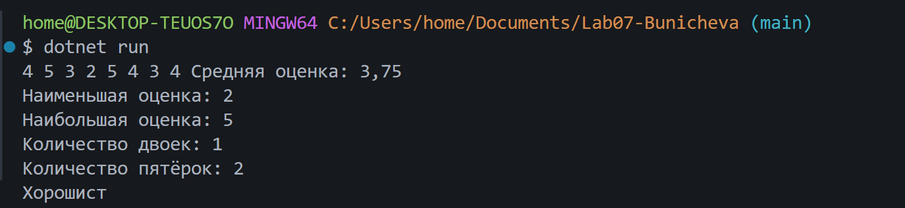
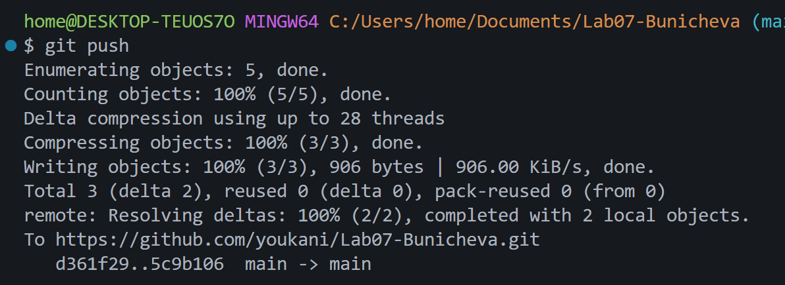

# Практическая работа №7
**ФИО:** Буничева Алёна Алексеевна
**Группа:** ИСП-242
**Дата:** 15.10.2026

## Что изучено
- Индексация элементов в массивах C# всегда начинается с числа 0.
- Цикл `foreach` перебирает сами значения, а не индексы. Если нужно изменять элементы по ходу цикла или использовать их индексы, вместо него обязательно нужно применять цикл `for`.
- Способ разворота массива «на месте» без создания копии: цикл должен дойти ровно до середины массива, меняя противоположные элементы местами через третью временную переменную.

## Скриншоты
 
